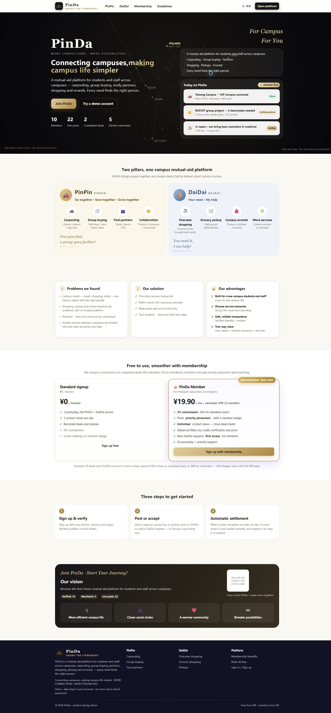
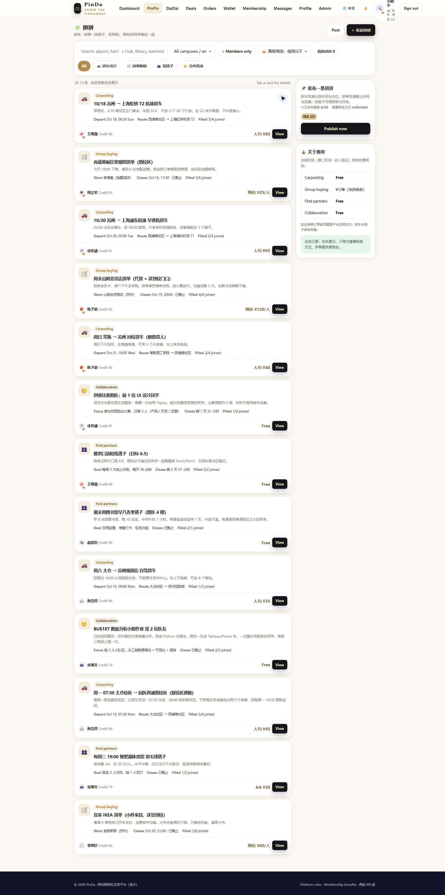
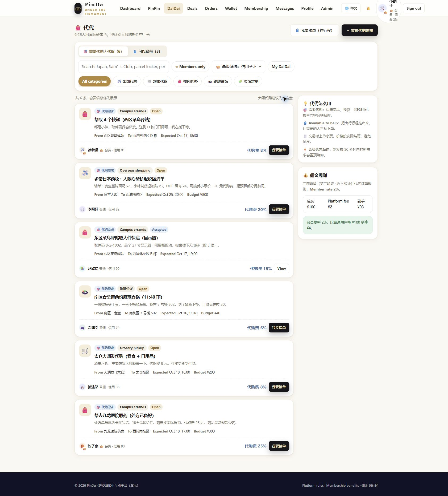
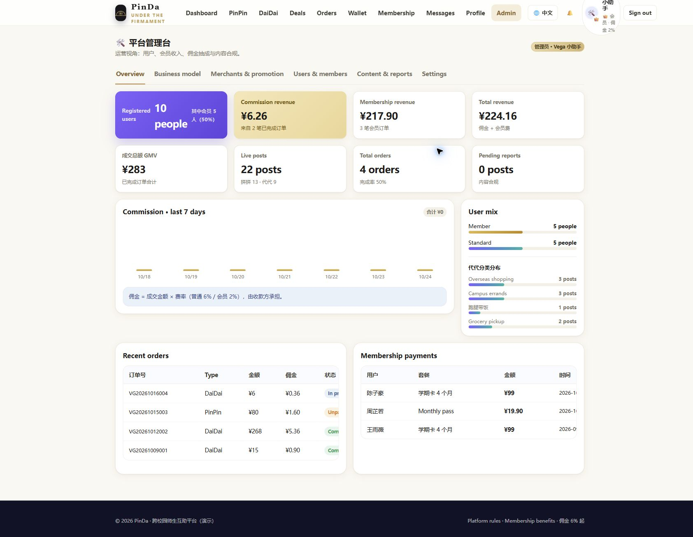

# PinDa · 跨校园师生互助平台

**连接校园，让校园生活更简单** · MORE CONNECTIONS · MORE POSSIBILITIES

PinDa 是面向跨校园师生用户的互助平台，两大板块：

- **拼拼 PINPIN** —— 一起出发 · 一起省钱 · 一起成长：拼车出行、拼单购物、找搭子、合作机会
- **代代 DAIDAI** —— 你的需求 · 我来帮你：出国代购、超市代取、校园代办、跑腿带饭、灵活定制

本仓库是一版**完整可点击、可跑通业务流程**的原型：纯前端单页应用（原生 JS，无框架 / 无构建 / 无第三方依赖）+ 一个零依赖 Node 服务（校园邮箱验证码真实发信）。



## 目录

- [功能一览](#功能一览)
- [快速开始](#快速开始)
- [演示账号](#演示账号)
- [邮箱验证码（可选）](#邮箱验证码可选)
- [技术栈](#技术栈)
- [目录结构](#目录结构)
- [设计说明](#设计说明)
- [安全与隐私](#安全与隐私)
- [已知边界](#已知边界)
- [详细文档](#详细文档)

## 功能一览

**账号与身份认证**

- 手机号注册（昵称、校区、专业、年级、一句话介绍），注册送 ¥100 体验金
- 两种登录：手机号登录 / 学号登录，均为 PinDa 平台密码 —— **不接触任何学校的统一身份密码**
- 身份认证：学号 + 校园邮箱验证码（一次一码、10 分钟有效），认证后获得「已认证」标识
- 校区 SIP / TC，专业取自官方专业库（141 个，按本硕博分组），支持「其它专业」手填

**拼拼**

- 四类信息：拼车出行、拼单购物、找搭子、合作机会
- 拼车支持常用线路一键填入，详情页带出行安全提示（认证状态、信用分、车型座位、行程分享）
- 按类型 / 校区 / 关键词筛选；会员可「只看会员发布」与按信用分筛选
- 加入、退出、成团结算、支付、交付、评价全流程；联系方式按额度打码，会员不限次

**代代**

- 双身份：发「代购需求」，或挂出「可以帮带」的行程
- 五类场景；接单 / 下单即生成订单，状态留痕（待支付 → 进行中 → 已交付 → 已完成 / 已取消）
- 代购费两种计法：≤50 视为百分比，>50 视为固定金额

**交易、钱包与商业化**

- 订单页展示费用拆解（成交额 / 平台费用 / 到手 / 应付），免费场景明确标注「本阶段免收」
- 钱包：余额、累计收支、平台费用、充值提现（模拟）、全部流水
- 三阶段收费（管理台一键切换）：启动期全免 → 收入验证（代代抽佣 6%、会员 2%、拼单 ¥1 / 单）→ 规模扩张
- 会员：月卡 ¥19.9 / 学期卡 ¥99（优先展示、高级筛选、不限次联系方式、服务费减免）
- 增值：信息加曝光 ¥1.9（24 小时置顶）
- 校园优惠：合作商家、优惠券领取与核销、后台核销率与推广收入统计
- 管理台：数据概览、商业化面板、商家与推广、用户与会员、内容与举报、平台设置

**体验**

- 中英文一键切换（约 500 条词典 + 组合句式规则），用户发布内容保持原文
- 首页首屏为**真实星图**：2950 颗恒星（星等 ≤5.5）、12 个星座连线、立体投影、绕北极星自转、北斗指北

## 快速开始

需要 [Node.js](https://nodejs.org)（可选，用于启动服务与真实发信）。

```bash
git clone https://github.com/<你的用户名>/PinDa.git
cd PinDa
node server.js
```

打开 **http://pinda.localhost:5173/**（浏览器原生支持的域名，推荐）或 **http://127.0.0.1:5173/pinda/**。

Windows 下也可以直接双击 `启动本地预览.cmd`。

- 同一 Wi-Fi 的手机 / 其它电脑：访问启动窗口打印的 `http://<局域网IP>:5173/`
- 不想起服务：直接双击 `index.html`。功能完整，但验证码只能走演示模式，数据只存在本机浏览器
- 想临时分享给评委 / 同学：先启动服务，再双击 `共享给他人.cmd`，会打印一个临时公网链接

## 演示账号

密码统一为 `123456`，登录页有「一键进入」按钮。

| 身份 | 手机号 | 说明 |
| --- | --- | --- |
| 普通用户 | 13800000001 | 李明轩，抽佣 6%、每日 3 条发布、每日 3 次看联系方式 |
| 会员用户 | 13800000002 | 王雨薇，抽佣 2%、优先展示、服务费免收、不限次联系方式 |
| 管理员 | 19900000000 | 平台运营台：切阶段、改费率、管商家、下线内容 |

## 邮箱验证码（可选）

默认**演示模式**：验证码直接显示在页面上，方便本地演示。

要真实发到校园邮箱（`*.edu.cn` / `*.edu`）：

1. 复制 `config.example.json` 为 `config.json`，填写 SMTP 账号与**授权码**（不是邮箱登录密码）；
2. 或双击 `配置邮箱.cmd`，向导会问你三个问题、写好配置并当场发一封测试邮件；
3. 重新启动服务，控制台会打印 `邮箱验证码：真实发送（smtp.qq.com:465 …）`。

也可以完全用环境变量（部署时不落盘）：`VEGA_SMTP_HOST` / `VEGA_SMTP_PORT` / `VEGA_SMTP_SECURE` / `VEGA_SMTP_USER` / `VEGA_SMTP_PASS` / `VEGA_MAIL_FROM`。

> `config.json` 含邮箱授权码，已在 `.gitignore` 中排除，请勿提交。

服务端已内置的保护：仅校园邮箱域名、同邮箱 60 秒冷却、每邮箱每日 10 次、每 IP 每小时 30 次、单码最多试 5 次、全站每日 300 封、验证码只在服务端校验、`config.json` 禁止下载（403）。

## 技术栈

- **前端**：原生 JavaScript（ES5 语法，无构建步骤、无框架、无依赖）、单页应用 + hash 路由、单一 CSS 文件
- **后端**：Node.js 内置 `http` / `https` / `net` / `crypto`（无 npm 依赖），静态服务 + 验证码接口 + SMTP 客户端（手写，支持 STARTTLS）
- **数据**：浏览器 `localStorage`（原型阶段，无数据库）+ 一份真实星表 `assets/data/sky.json`
- **国际化**：自建词典 + 组合句式规则，渲染后统一替换文本节点与 `placeholder` / `title`

## 目录结构

```
PinDa/
├─ index.html              单页应用外壳
├─ server.js               本地服务：静态托管 + 邮箱验证码接口
├─ mailer.js               SMTP 发信（含配置向导与测试邮件）
├─ config.example.json     邮箱配置模板（复制为 config.json 使用）
├─ 启动本地预览.cmd         Windows 一键启动
├─ 共享给他人.cmd           临时公网隧道（localhost.run）
├─ 配置邮箱.cmd / 配置邮箱.js  发件邮箱配置向导
├─ assets/
│   ├─ styles.css          全部样式（品牌变量在顶部）
│   ├─ data/sky.json       真实星表（2950 颗恒星 + 12 星座连线）
│   └─ js/
│      ├─ data.js          数据模型、演示数据、收费规则、佣金逻辑
│      ├─ programmes.js    官方专业库（141 个）
│      ├─ skymap.js        星图渲染引擎（球面投影 + 自转）
│      ├─ i18n.js          中英词典与句式规则
│      ├─ ui.js            组件与工具（Logo、弹窗、支付、图表）
│      ├─ views.public.js  落地页、板块介绍、注册登录、平台规则
│      ├─ views.market.js  工作台、拼拼、代代、发布与详情
│      ├─ views.me.js      订单、钱包、会员、消息、个人中心
│      ├─ views.deals.js   校园优惠
│      ├─ views.admin.js   管理台
│      └─ app.js           路由、权限与业务动作
├─ screenshots/            14 张整页截图
└─ docs/                   详细使用说明与交接单
```

## 设计说明

| 项 | 说明 |
| --- | --- |
| 标识 | 拱门 + 圆环 + 四芒星（金色线稿），衬线体 PinDa，下方 UNDER THE FIRMAMENT；内联 SVG，可在 `ui.js` 中一处替换 |
| 主色 | 墨黑 `#17161A` / 金 `#B98A3C` / 米白 `#FBF8F1`；拼拼金色系，代代学院蓝 `#3E6E9E` |
| 星图 | 首屏按真实星表做立体投影，视场中心对准北天极；金色虚线画出北斗七星 → 北极星的指北延长线 |
| 寓意 | 星图是最古老的导航工具（北斗指北、郑和牵星术）；对应「在校园里找到合适的人」 |

## 安全与隐私

- **不索取、不代持任何学校的统一身份账号密码**（如 e-Bridge）。多数高校的 SSO 没有对外开放授权，代持密码属于钓鱼特征；如需一键登录，应向学校申请官方 SSO。
- SMTP 授权码只存在于服务端 `config.json` / 环境变量，前端拿不到，也不参与验证码判定。
- 只接受校园邮箱域名，接口带多维限流，验证码一次一码、校验即失效。

## 已知边界

- 支付、提现、券核销、学生认证均按原型模拟；验证码在配置 SMTP 后为真实发送。
- 账号与订单保存在浏览器 `localStorage`，多设备不互通；接真实后端时替换 `data.js` 的读写层即可。
- 商家与校园组织合作（收入点 5）尚未实现，管理台中标注「规划中」。
- 验证码存在服务端内存，部署需单实例常驻（Render / Railway / VPS），Serverless 需改用共享存储。

## 详细文档

- [使用说明](docs/使用说明.md) —— 完整功能说明、部署、配置、维护
- [交接说明](docs/交接说明.md) —— 项目交接单（当前配置、待办）

## 截图

| 页面 | 预览 |
| --- | --- |
| 首页 |  |
| 拼拼 |  |
| 代代 |  |
| 管理台 |  |

其余截图见 [screenshots/](screenshots/)：登录、注册、工作台、校园优惠、订单、钱包、会员中心、消息、个人中心、平台规则。

## License

暂未指定开源许可证。如需公开复用，请先加上 `LICENSE`（例如 MIT）并在此处声明。
